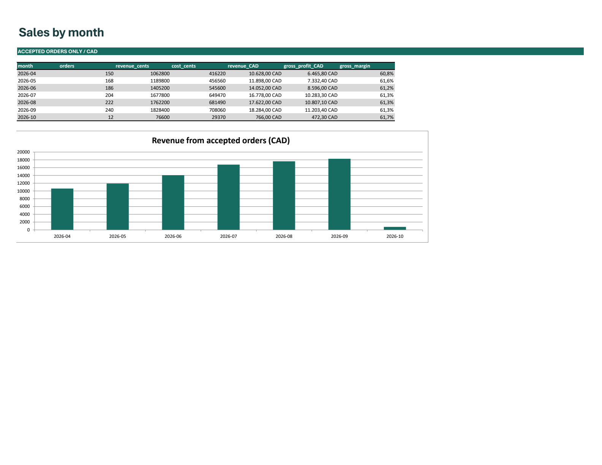

# Northline Excel refresh

Turn monthly CSV files into a sales report with visible exceptions and a reconciliation trail. This is a fictional retail portfolio example with synthetic data and AI-assisted implementation. No client outcome or time savings is claimed.

## Try it

Download the complete ZIP from [Releases](https://github.com/JhinxDev/northline-excel-refresh/releases), extract it, and open `northline-refresh.xlsx` in Windows Excel with Power Query. Cached example results are visible immediately.

Before refreshing, set the `DataRoot` query to the absolute path of the extracted `fixtures` directory. The workbook deliberately ships with `SET_YOUR_FIXTURES_FOLDER` instead of a developer's path. See [first-run instructions](OPERATOR-GUIDE.md). Refresh requires local file access; Excel may show normal privacy and external-content prompts.

## What it demonstrates

- A local folder of monthly UTF-8 CSV files, plus a product master.
- Explicit numeric/date validation, duplicate-order detection and SKU matching.
- Accepted orders separated from exceptions with source filename and row number.
- Revenue, cost, gross profit and monthly order counts with row/value reconciliation.
- Editable [Power Query source](source/AllRows.m), [expected results](evidence/expected.json) and [native Excel verification](VERIFICATION.md).

The included exercise has 1,193 input rows, 1,182 accepted orders and 11 intentional exceptions. Accepted synthetic revenue is CAD 90,028.00. Three rows have invalid numeric data and cannot be assigned a trustworthy dollar amount. Every copy of a duplicate ID is excluded pending correction.

## Delivery boundaries

One row means one order containing one product. Gross profit excludes overhead, shipping, tax and returns. No VBA, credentials, cloud service, scheduler, order backend or website connection is included. The browser Northline portfolio demo is a separate implementation.

Native Windows Excel 16.0 was tested. Mac, Excel Online, arbitrary numeric magnitudes, large datasets and concurrent input editing are unverified. The chart and print range cover the seven supplied months; extend them for additional reporting periods. Failed refreshes may leave older cached output, so check completion and exceptions before using a report.

This example supports a bounded spreadsheet/import service. A real delivery still requires agreed business rules, representative-data reconciliation and buyer operator acceptance. It is not an unrestricted business-management system.

## Reproduce

End users need Excel only. Rebuilding the workbook shell requires Python 3 and XlsxWriter 3.2.9. Native query execution and tests require PowerShell and installed Windows Excel. Use a disposable copy and follow [the operator guide](OPERATOR-GUIDE.md). No spreadsheet compatibility or human usability certification is implied.

Version 1.1.0 introduces a portable public package and removes workstation metadata. The validation rules and synthetic totals match the verified earlier implementation. See [changes](CHANGELOG.md).

Source is published for inspection. No additional open-source reuse license is granted in this release.
